# Informe Ejecutivo: Medición NPS, Transferencia Metodológica y Proyectos Destacados
## Programa de Formación: Negocios Digitales y Circulares para El Loa 2026
**Instrumento:** Viraliza Formación Corfo — **Código de Proyecto:** 25VIRTL-307464  
**Entidades Formativas Aliadas:** INACAP Sede Calama y AIEP Calama  
**Territorio de Impacto:** Provincia de El Loa (Calama, Chiu Chiu, San Pedro de Atacama), Región de Antofagasta  
**Fecha de Emisión:** Noviembre 2026  

---

## 1. Resumen Ejecutivo y Hallazgos Principales

El presente informe consolida la evaluación de impacto, asistencia, transferencia cognitiva y satisfacción de los participantes del **"Programa de Negocios Digitales y Circulares para El Loa 2026"**, ejecutado con financiamiento de Comité Corfo Antofagasta. 

A través del cruce de las listas presenciales de asistencia, las evaluaciones de línea base (**Ex-ante**) y los diagnósticos finales de salida (**Ex-post**), se obtuvieron los siguientes resultados estratégicos:

```
+----------------------------------------------------------------------------------------------------+
|                                    MÉTRICAS CLAVE DEL PROGRAMA                                      |
+--------------------+-----------------------+--------------------+----------------------------------+
|      44 ALUMNOS    |       20 ALUMNOS      |     11 EXPOSITORES |            4 PROYECTOS           |
| Atendidos en Total |  Cohorte Certificada  |  Pitch Day Final   |       Incentivos Asignados       |
+--------------------+-----------------------+--------------------+----------------------------------+
|    NPS SCORE: +45.0|  DELTA COGNITIVO:     |   LÍNEA BASE: 3.16 |        SALIDA EX-POST: 4.41      |
|  Rango Excelencia  |  +1.25 pts (+39.6%)   |  Dominio Inicial   |        Dominio Final / 5.0       |
+--------------------+-----------------------+--------------------+----------------------------------+
```

### Hitos Destacados
1. **Validación de Aprendizaje Significativo ($\Delta = +1.25$ pts):** Los estudiantes iniciaron con un dominio intermedio-teórico (3.16 / 5.0) y finalizaron con un promedio de 4.41 / 5.0 (+39.6% de incremento neto). Los mayores saltos de transferencia se registraron en **Diseño de Negocio Sostenible ($\Delta = +1.66$)** y **Herramientas Digitales para Eficiencia ($\Delta = +1.55$)**.
2. **NPS en Nivel de Excelencia (+45.0 pts):** Con un 55.0% de Promotores, 35.0% de Pasivos/Neutros y sólo un 10.0% de Detractores, el programa supera con creces el estándar de la industria formativa y las metas Corfo.
3. **Diferenciación de la Salida Formativa:**
   - **11 Estudiantes (55%):** Completaron todo el ciclo lectivo y defendieron sus iniciativas en el **Pitch Day final**.
   - **9 Estudiantes (45%):** Llegaron a la etapa final y alcanzaron los requisitos de asistencia para certificación lectiva (**Sólo Diploma**), sin realizar defensa de proyecto.
4. **4 Iniciativas Seleccionadas con Incentivos:** De entre los proyectos expuestos, la comisión evaluadora de jurados seleccionó y premió a **4 proyectos destacados** por su pertinencia territorial, viabilidad técnica e integración de ODS.

---

## 2. Los 4 Proyectos Destacados y Evaluación de Jurados

La sesión final de Pitch Day contó con una comisión evaluadora compuesta por **Valentina Muñoz**, **Rodrigo Mérida** y **Cecilia Martínez**, quienes evaluaron en una escala de 1 a 25 puntos considerando: definición del problema territorial, originalidad, comunicación/pitch, integración de herramientas digitales y competencias técnicas de innovación.

| Proyecto | Equipo y Casa de Estudios | Puntaje Medio (s/25) | % Logro | Eje Territorial y Solución | Incentivo Asignado |
| :--- | :--- | :---: | :---: | :--- | :--- |
| **Ecoesmart** | Felipe Vergara, Cristian Salfate, Lorens Barboza *(INACAP)* | **17.33** | 69.3% | Sistema de reciclaje incentivado y trazabilidad digital de botellas PET con plataforma digital (Redimir/Reciclaz) y sensores. Prototipo MVP presentado ante jurado. | **Incentivo de Aceleración y Prototipado** |
| **Recompost** | Carlos Olave Godoy, Mariana Zambrana, Jair Rodriguez *(INACAP)* | **17.33** | 69.3% | Red comunal de compostaje y basureros inteligentes con gamificación y asistencia de IA para la reducción masiva de residuos orgánicos urbanos en Calama. | **Incentivo de Aceleración y Prototipado** |
| **TecnMin** | Joaquin Yufla Anza y equipo *(INACAP)* | **14.00** | 56.0% | Plataforma IoT y tecnologías habilitantes para la descarbonización en operaciones y empresas contratistas mineras de la cuenca de El Loa. | **Reconocimiento a la Innovación Territorial Minera** |
| **Calama se reconstruye** | Lucy Tinte Reyes, Yoset Manacá, Ingri Gahona *(AIEP)* | **13.67** | 54.7% | Fabricación y rediseño de mobiliario urbano ecológico a partir de la recuperación y valorización de descartes y residuos comunales. | **Reconocimiento a la Circularidad Comunitaria** |

> [!TIP]
> **Dictamen del Jurado:** El jurado destacó transversalmente la oratoria de los equipos, el avance a nivel de Producto Mínimo Viable (MVP) alcanzado por **Ecoesmart** y el alto potencial de escalabilidad pública de **Recompost** mediante alianzas municipales.

---

## 3. Curva de Transferencia Metodológica (Ex-ante vs. Ex-post)

La comparación de los diagnósticos refleja cómo el programa cerró brechas estructurales en habilidades digitales y circulares:

| Módulo Formativo | Ex-ante (Línea Base) | Ex-post (Salida) | Ganancia Neta ($\Delta$) | Crecimiento Relativo |
| :--- | :---: | :---: | :---: | :---: |
| **M1. Innovación Sostenible** | 3.39 | 4.45 | **+1.06** | +31.3% |
| **M2. Diseño de Negocio Sostenible** | 2.87 | 4.53 | **+1.66** | +57.8% |
| **M3. Herramientas Digitales para Eficiencia** | 3.10 | 4.65 | **+1.55** | +50.0% |
| **M4. Modelos de Negocio Circulares** | 2.77 | 3.85 | **+1.08** | +39.0% |
| **M5. Liderazgo y Gestión Verde** | 3.48 | 4.37 | **+0.88** | +25.4% |
| **M6. Tendencias Tecnológicas** | 3.03 | 3.84 | **+0.81** | +26.7% |
| **M7. Comunicación / Pitch Day** | 3.45 | 4.79 | **+1.34** | +38.8% |
| **Promedio Global Ponderado** | **3.16** | **4.41** | **+1.25** | **+39.6%** |

```mermaid
xychart-beta
    title "Comparativa de Dominio de Competencias (1-5)"
    x-axis ["M1. Innovación", "M2. Negocio Sost.", "M3. Digital", "M4. Circular", "M5. Liderazgo", "M6. Tendencias", "M7. Pitch"]
    y-axis "Escala 1 a 5" 1 --> 5
    bar [3.39, 2.87, 3.10, 2.77, 3.48, 3.03, 3.45]
    bar [4.45, 4.53, 4.65, 3.85, 4.37, 3.84, 4.79]
```



---

## 4. Análisis de Satisfacción NPS (Net Promoter Score)

El índice NPS se construyó clasificando el promedio de salida de cada participante:
* **Promotores (Nota $\ge$ 4.5):** 11 alumnos (**55.0%**)
* **Pasivos / Neutros (Nota 3.8 a 4.4):** 7 alumnos (**35.0%**)
* **Detractores (Nota $<$ 3.8):** 2 alumnos (**10.0%**)

$$\text{NPS} = \% \text{Promotores} - \% \text{Detractores} = 55.0\% - 10.0\% = \mathbf{+45.0}$$

### Segmentación por Perfil y Casa de Estudios:
* **Expositores con Proyecto (N=11):** Promedio 4.41 | **NPS +45.5** (6 Promotores, 4 Pasivos, 1 Detractor).
* **Finalistas Sólo Diploma (N=9):** Promedio 4.42 | **NPS +44.4** (5 Promotores, 3 Pasivos, 1 Detractor).
* **INACAP Sede Calama (N=8):** Promedio 4.38 | **NPS +37.5**.
* **AIEP Calama (N=12):** Promedio 4.44 | **NPS +50.0**.

---

## 5. Matriz de Evidencias de Transferencia Cualitativa

Los testimonios directos de los 11 equipos expositores dan cuenta de una apropiación territorial tangible:
* **Felipe Vergara C. (Ecoesmart - INACAP):** *"Nuestro proyecto ataca directamente la producción de plásticos PET, reutilizándolos y dándoles una segunda vida... Las herramientas más destacadas fueron IA y Marketing para construir el pitch asistido."*
* **Carlos Olave Godoy (Recompost - INACAP):** *"La enseñanza sobre Inteligencia Artificial influyó directamente en mi propuesta para el diseño del contenedor inteligente... La meta es resolver la necesidad de implementar el compostaje a la comunidad."*
* **Lucy W. Tinte Reyes (Calama se reconstruye - AIEP):** *"Sostenibilidad buscando buenas propuestas en la naturaleza. Logramos incorporar indicadores de energía y uso de IA... Buenísimos pitches y cambio educacional."*
* **Joaquin Yufla Anza (TecnMin - INACAP):** *"Con los contenidos vistos logro identificar con más claridad los modelos de negocio. La tecnología es una herramienta que logra impulsar proyectos entre la formación técnica y el mundo industrial."*

---

## 6. Recursos y Accesos del Proyecto

Todos los datos se encuentran respaldados y accesibles:
* 📊 **Hoja de Cálculo Oficial (Google Sheets):** [Información Participantes](https://docs.google.com/spreadsheets/d/11WuFrvQDqUyUOGWH9VXCKtdoiFUVeoQOnhZTgswcXLU/edit?usp=drivesdk)
* 🌐 **Dashboard Interactivo Local:** [dashboard_transicion_verde_calama.html](file:///C:/Users/olfor/.gemini/antigravity/scratch/transicion_verde_calama/dashboard_transicion_verde_calama.html)
* 📁 **Carpeta de Proyecto Google Drive:** [TRANSICIÓN VERDE CALAMA](https://drive.google.com/drive/folders/1VTHXHjsHzPaKCC_3cBzLrec8AaRm3BJ3)
